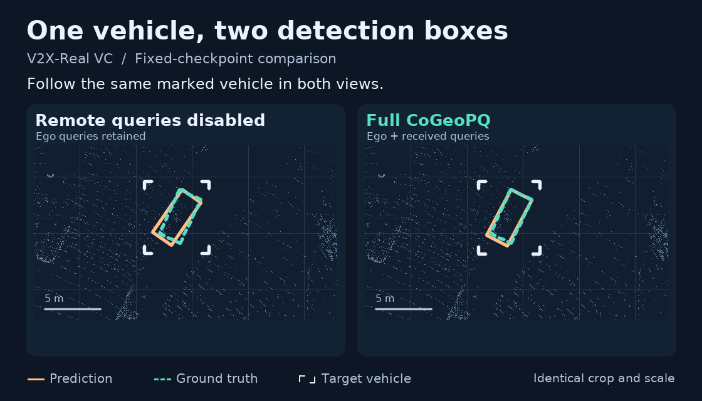

# CoGeoPQ

Bandwidth-constrained multimodal cooperative perception via geometry-aware probabilistic queries.

[Watch the full demonstration (MP4)](assets/cooperative-perception.mp4) · [View the still preview](assets/preview-poster.png)

The offline V2X-Real vehicle-centric replay shows the ego vehicle and three collaborators. The left and right panels show the same scene and ground truth under a fixed-checkpoint diagnostic. The left panel keeps the ego queries and disables received queries. The right panel uses the complete cooperative pipeline. The mechanism close-ups follow a second vehicle from the same sequence.

## How cooperation works

- **Local geometry enrichment.** Nearby LiDAR bird’s-eye-view features contribute spatial context to each agent’s queries.
- **Utility-based query communication.** Objectness and localization uncertainty guide which queries fit the sender’s communication budget.
- **Geometry-constrained probabilistic fusion.** The receiver associates compatible queries and updates the ego position, uncertainty, and semantic evidence before 3D detection.

On the V2X-Real VC test set (1,253 ego samples), full CoGeoPQ achieves **43.55% BEV mAP@0.5** at a limit of 128 queries per sender. The separate local-context, objectness-only, and query-concatenation controls reach 16.18%, 37.69%, and 33.28%, respectively.

## Code release

Code release is planned after paper acceptance.

## Data acknowledgment

The experiments use V2X-Real by Xiang et al. (ECCV 2024), UCLA Mobility Lab. [Dataset project page](https://mobility-lab.seas.ucla.edu/v2x-real/)
